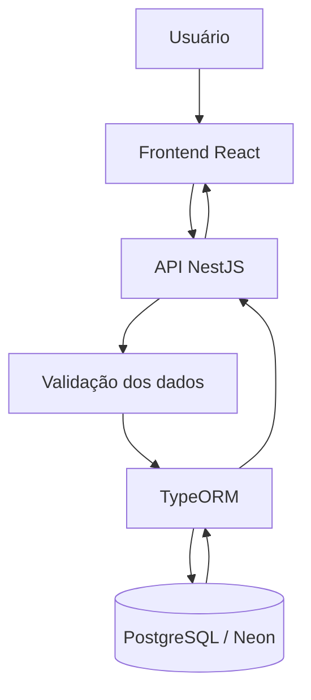
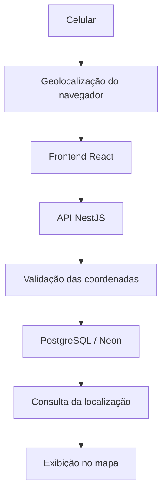

# 🚌 No Ponto — Sistema Distribuído para Monitoramento de Ônibus

**Seu ônibus. Sua rota. Seu tempo.**

## 1. Sobre o projeto

O **No Ponto** é um sistema desenvolvido com o objetivo de facilitar o acompanhamento de ônibus públicos e escolares.

A proposta permite o gerenciamento de veículos, rotas, paradas, usuários e informações de localização, oferecendo uma forma mais prática de acompanhar o transporte.

O projeto está sendo desenvolvido como atividade acadêmica da disciplina de **Fundamentos da Computação Concorrente, Paralela e Distribuída**, explorando a organização dos serviços e o processamento das informações.

## 2. Objetivos

- Gerenciar ônibus, rotas, paradas e usuários.
- Permitir a identificação dos veículos por meio de identificadores RFID.
- Registrar informações de localização utilizando GPS.
- Disponibilizar informações por meio de uma API.
- Desenvolver uma interface para visualização e gerenciamento dos dados.
- Explorar conceitos de computação concorrente e distribuída.

## 3. Tecnologias utilizadas

| Tecnologia | Finalidade |
|---|---|
| TypeScript | Linguagem utilizada no desenvolvimento |
| Node.js | Ambiente de execução do backend |
| NestJS | Framework para construção da API |
| TypeORM | Comunicação entre backend e banco de dados |
| PostgreSQL | Banco de dados relacional |
| Neon | Hospedagem do banco de dados |
| React | Construção da interface |
| Vite | Ambiente de desenvolvimento do frontend |
| Tailwind CSS | Estilização da interface |
| Leaflet | Recursos de mapas e localização |
| Axios | Comunicação HTTP com a API |
| React Router | Navegação entre páginas |
| Lucide React | Biblioteca de ícones |

## 4. Justificativa das tecnologias escolhidas

As tecnologias foram escolhidas considerando a facilidade de desenvolvimento, organização do código, integração entre os componentes e possibilidade de expansão do sistema.

- **TypeScript:** permite trabalhar com tipagem, facilitando a manutenção e identificação de erros.
- **Node.js:** possibilita executar o backend utilizando JavaScript e operações assíncronas.
- **NestJS:** oferece uma estrutura organizada para desenvolver APIs e separar as responsabilidades do sistema.
- **TypeORM:** facilita o mapeamento e a manipulação dos dados no banco PostgreSQL.
- **PostgreSQL:** permite armazenar informações estruturadas e relacionamentos entre as entidades.
- **Neon:** oferece hospedagem de PostgreSQL na nuvem.
- **React:** facilita a criação de interfaces dinâmicas e reutilizáveis.
- **Vite:** proporciona um ambiente rápido para desenvolvimento do frontend.
- **Tailwind CSS:** facilita a criação e organização dos estilos.
- **Leaflet:** permite trabalhar com mapas e representar informações geográficas.
- **Axios:** facilita a realização de requisições HTTP entre frontend e backend.
- **React Router:** permite organizar a navegação entre as telas.
- **Lucide React:** disponibiliza ícones para a interface.

## 5. Alternativas tecnológicas analisadas

Existem outras tecnologias que poderiam ser utilizadas no desenvolvimento do sistema. Algumas alternativas são:

| Tecnologia escolhida | Alternativa | Justificativa da escolha |
|---|---|---|
| NestJS | Express | NestJS oferece uma estrutura mais organizada para separar módulos e responsabilidades. |
| TypeORM | Prisma | TypeORM foi mantido por já estar integrado ao backend desenvolvido. |
| PostgreSQL | MySQL | PostgreSQL atende às necessidades de armazenamento e relacionamentos do projeto. |
| React | Angular | React permite desenvolver a interface utilizando componentes reutilizáveis. |
| Leaflet | Google Maps | Leaflet permite trabalhar com mapas utilizando uma biblioteca de código aberto. |

Essas alternativas representam possibilidades técnicas de desenvolvimento. A escolha final considera a estrutura implementada e as necessidades do projeto.

## 6. Arquitetura do sistema

O sistema está organizado em duas partes principais:

- **Backend:** responsável pelas regras de negócio, comunicação com o banco de dados e disponibilização das informações.
- **Frontend:** responsável pela interface de interação com o usuário.

### Fluxo geral

1. O usuário interage com a interface.
2. O frontend realiza requisições para a API.
3. O backend recebe e valida as informações.
4. O TypeORM realiza a comunicação com o PostgreSQL.
5. A API retorna os dados para o frontend.
6. A interface apresenta as informações ao usuário.



### Fluxo do rastreamento GPS

O rastreamento utiliza a localização disponibilizada pelo navegador do celular. As coordenadas são enviadas para a API, armazenadas no banco de dados e utilizadas para representar a posição do ônibus no mapa.



## 7. Backend

O backend foi desenvolvido utilizando NestJS e TypeScript.

Sua responsabilidade é processar as requisições, validar os dados, executar as operações necessárias e realizar a comunicação com o banco de dados.

### Principais módulos

| Módulo | Responsabilidade |
|---|---|
| Ônibus | Cadastro, consulta, atualização e exclusão de veículos |
| Rotas | Gerenciamento das rotas |
| Paradas | Gerenciamento dos pontos de parada |
| Localização | Registro e consulta das coordenadas dos veículos |
| Usuários | Gerenciamento dos usuários |

### Funcionalidades implementadas

Os módulos possuem operações de gerenciamento de dados (CRUD):

- **Create:** cadastro de registros.
- **Read:** consulta e listagem de registros.
- **Update:** atualização de informações.
- **Delete:** exclusão de registros.

O módulo de ônibus também possui validação de dados, filtros por placa e status e paginação na consulta.

### Endpoints do módulo de Ônibus

| Método | Endpoint | Descrição |
|---|---|---|
| POST | `/onibus` | Cadastrar ônibus |
| GET | `/onibus` | Listar ônibus |
| GET | `/onibus/:id` | Consultar ônibus por ID |
| PATCH | `/onibus/:id` | Atualizar ônibus |
| DELETE | `/onibus/:id` | Excluir ônibus |

### Rastreamento GPS

O módulo de localização permite:

- Capturar a localização utilizando a Geolocation API do navegador.
- Enviar latitude e longitude para o backend.
- Validar as coordenadas recebidas.
- Associar a localização a um ônibus cadastrado.
- Armazenar os registros no PostgreSQL.
- Consultar as últimas localizações e exibir a posição no mapa.

O rastreamento foi testado utilizando um celular, com autorização de acesso à localização pelo navegador.

### Identificação por RFID

O projeto prevê a utilização de RFID para identificação dos ônibus.

Atualmente, o sistema possui o campo de identificação RFID associado ao cadastro do veículo. Entretanto, a leitura automática por meio de um dispositivo físico ainda não foi integrada.

A integração com leitores RFID poderá ser desenvolvida em uma etapa futura.

## 8. Frontend

O frontend foi desenvolvido utilizando React, TypeScript e Vite.

A interface possui uma estrutura de painel administrativo, com navegação lateral e áreas destinadas à apresentação e ao gerenciamento das informações do sistema.

### Elementos da interface

- Painel inicial.
- Área de gerenciamento de ônibus.
- Área de rotas.
- Área de paradas.
- Área de usuários.
- Rastreamento GPS.
- Visualização de localização dos ônibus no mapa.

O objetivo é oferecer uma interface simples e organizada para facilitar o acesso às funcionalidades.

## 9. Concorrência e distribuição

A disciplina de Fundamentos da Computação Concorrente, Paralela e Distribuída propõe explorar formas de organizar e executar tarefas computacionais.

No contexto do No Ponto, um cenário de aplicação desses conceitos é o recebimento de várias atualizações de localização de ônibus ao mesmo tempo.

O processamento dessas informações pode ser organizado por serviços independentes, permitindo distribuir tarefas e evitar que todas as operações fiquem concentradas em um único componente.

**Observação:** os mecanismos específicos de concorrência e distribuição devem ser descritos conforme forem implementados e testados no projeto. A arquitetura atual não comprova, por si só, o uso de filas ou workers.

## 10. Custos do projeto

O desenvolvimento prioriza ferramentas gratuitas ou de código aberto.

| Recurso | Tecnologia | Custo |
|---|---|---|
| Linguagem | TypeScript | Gratuito |
| Backend | NestJS e Node.js | Gratuito |
| ORM | TypeORM | Gratuito |
| Banco de dados | PostgreSQL | Gratuito (software) |
| Hospedagem do banco | Neon | Conforme o plano utilizado |
| Frontend | React e Vite | Gratuito |
| Estilização | Tailwind CSS | Gratuito |
| Mapas | Leaflet | Gratuito |

Os custos de hospedagem, infraestrutura e eventuais serviços externos devem ser atualizados de acordo com os planos efetivamente utilizados.

O projeto acadêmico utiliza ferramentas de desenvolvimento e serviços disponíveis para testes. Uma implantação em ambiente real poderá exigir custos adicionais, como hospedagem, equipamentos GPS e leitores RFID.

## 11. Demonstração do funcionamento

O sistema foi executado e testado utilizando o backend NestJS, o frontend React e o banco PostgreSQL hospedado no Neon.

Foram realizados testes das operações de cadastro, consulta, atualização e exclusão nos módulos de:

- Ônibus.
- Rotas.
- Paradas.
- Usuários.

Também foi realizado o teste de rastreamento GPS utilizando um celular.

### Resultados dos testes

- Cadastro de registros pela interface.
- Consulta e listagem dos dados.
- Atualização de informações.
- Exclusão de registros.
- Validação dos dados enviados.
- Captura e envio de coordenadas GPS.
- Armazenamento da localização no banco de dados.
- Exibição da posição do ônibus no mapa.

### Evidências

Adicionar nesta seção:

- Captura da interface do frontend.
- Captura da API em execução.
- Exemplo de cadastro de ônibus.
- Exemplo de consulta dos dados.
- Captura do banco de dados.
- Captura do rastreamento GPS pelo celular.
- Demonstração dos recursos de concorrência e distribuição, quando implementados.

## 12. Como executar o projeto

### Pré-requisitos

- Node.js e npm instalados.
- Acesso ao banco PostgreSQL hospedado no Neon.
- Git instalado.

### Backend

Acesse a pasta do backend:

```bash
cd backend
```

Instale as dependências:

```bash
npm install
```

Configure as variáveis de ambiente no arquivo `.env`, utilizando as credenciais do banco de dados:

```env
DATABASE_URL="SUA_URL_DO_BANCO"
DIRECT_URL="SUA_URL_DE_CONEXAO_DIRETA"
```

Compile o projeto:

```bash
npm run build
```

Execute as migrations:

```bash
npm run migration:run
```

Inicie o servidor:

```bash
npm run start:dev
```

A API ficará disponível em:

```text
http://localhost:3000
```

### Frontend

Em outro terminal, acesse a pasta do frontend:

```bash
cd frontend
```

Instale as dependências:

```bash
npm install
```

Configure a variável de ambiente `VITE_API_URL` no arquivo `.env`, apontando para o endereço da API:

```env
VITE_API_URL="http://localhost:3000"
```

Inicie o servidor de desenvolvimento:

```bash
npm run dev
```

O frontend ficará disponível no endereço informado pelo Vite, normalmente:

```text
http://localhost:5173
```

**Observação:** os comandos de execução e as variáveis de ambiente devem corresponder à configuração atual do repositório.

## 13. Banco de dados

O sistema utiliza PostgreSQL hospedado na plataforma Neon, com TypeORM para comunicação entre a aplicação e o banco de dados.

As principais entidades são:

- Rota.
- Ônibus.
- Parada.
- Localização.
- Usuário.
- UsuarioFavoritaRota.

A entidade `UsuarioFavoritaRota` representa o relacionamento muitos-para-muitos (N:N) entre usuários e rotas, permitindo que os usuários mantenham rotas favoritas.

As informações de localização são armazenadas e associadas aos ônibus cadastrados.

**Importante:** as credenciais de acesso ao banco de dados devem permanecer no arquivo `.env`, que não deve ser enviado ao GitHub.

## 14. Limitações e trabalhos futuros

Apesar das funcionalidades já desenvolvidas, algumas melhorias podem ser realizadas em etapas futuras:

- Integrar um leitor RFID físico para identificação automática dos ônibus.
- Integrar equipamentos GPS instalados nos veículos.
- Aprimorar o acompanhamento da localização em tempo real.
- Implementar mecanismos específicos de concorrência e distribuição, conforme os requisitos da disciplina.
- Melhorar a experiência dos passageiros com informações de rotas e previsão de chegada.
- Preparar o sistema para implantação em ambiente de produção.

## 15. Equipe de desenvolvimento

- **Eduardo Artur**
- **Emerson Sousa**
- **Hícaro Luiz**
- **Marjory Leticia**

Projeto acadêmico desenvolvido em equipe no curso de Análise e Desenvolvimento de Sistemas.

---

**No Ponto — Seu ônibus. Sua rota. Seu tempo.**
